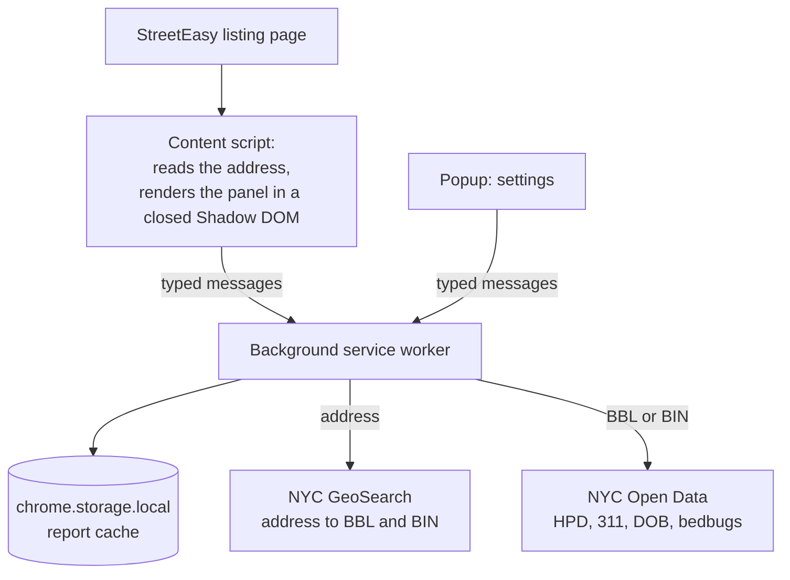

# Stoop: NYC Building Checker

[](https://github.com/isakpeder/nyc-building-checker/actions/workflows/ci.yml)

A Chrome extension that shows a building's public record right on its StreetEasy listing.

NYC publishes housing code violations, 311 complaints, stop-work orders and bedbug filings, but they're spread across several city sites, and most renters only look them up by hand before a tour, if at all. Stoop reads the address of the listing you're viewing, matches it to the city's building records and shows the key facts in a panel on the page, each linked to its public source.

<!-- Screenshot: the panel on a listing page. -->

## Features

- **Housing violations (HPD):** open violations on record by class, with class C (immediately hazardous) highlighted, and closures in the last five years.
- **311 complaints:** incidents in the last three years by category, with repeated reports of the same problem on the same day counted once.
- **Stop-work orders (DOB):** orders in force and recently lifted.
- **Bedbug filings:** the latest filing, with "no filing on record" kept distinct from a filing reporting zero units.
- **Details:** a dialog with the full text of each open violation, recent 311 incidents and stop-work orders.
- **Safe matching:** a report is shown only when the city's geocoder returns the same street and borough as the listing. Otherwise Stoop shows no report rather than a wrong one.
- **No server:** the extension calls NYC's public APIs directly and caches reports in the browser for a day.

## Install

**From a release:** download `stoop-vX.Y.Z.zip` from the [Releases](https://github.com/isakpeder/nyc-building-checker/releases) page and unzip it. Open `chrome://extensions`, turn on **Developer mode** and click **Load unpacked**, then choose the unzipped folder.

**From source:** see [Development](#development), then load the `dist` folder the same way.

Requires Chrome 116 or later.

## Development

Requires [Node.js](https://nodejs.org) 26 (see `.nvmrc`) and [pnpm](https://pnpm.io).

```sh
pnpm install            # install dependencies
pnpm run build          # build the extension into dist/
pnpm run dev            # build with live reload while editing
pnpm run test           # unit and component tests
pnpm run e2e            # end-to-end tests in Chromium
pnpm run lint           # lint
pnpm run typecheck      # type checks
pnpm run format         # format with Prettier
```

Anonymous usage analytics and the uninstall feedback form are off unless their keys are set at build time. Copy `.env.example` to `.env` to set them.

Pushing a `vX.Y.Z` tag that matches `package.json` runs CI and publishes the build to a GitHub Release.

## Architecture



More in [docs/ARCHITECTURE.md](docs/ARCHITECTURE.md).

## Data sources

All data comes from NYC's public APIs. Details, including how each dataset is queried and deduplicated, are in [docs/DATA_SOURCES.md](docs/DATA_SOURCES.md).

| Section            | Source                                                                               |
| ------------------ | ------------------------------------------------------------------------------------ |
| Address matching   | [NYC GeoSearch](https://geosearch.planninglabs.nyc)                                  |
| Housing violations | [HPD Housing Maintenance Code Violations](https://data.cityofnewyork.us/d/wvxf-dwi5) |
| 311 complaints     | [311 Service Requests](https://data.cityofnewyork.us/d/erm2-nwe9)                    |
| Stop-work orders   | [DOB Complaints Received](https://data.cityofnewyork.us/d/eabe-havv)                 |
| Bedbug filings     | [Bedbug Reporting](https://data.cityofnewyork.us/d/wz6d-d3jb)                        |

## Limitations

- **New York City only.** Listings elsewhere, such as Jersey City, show a note instead of a report.
- **Strict matching.** When the listing's address can't be matched to exactly one building with the same street and borough, no report is shown. Condos and buildings with several addresses are the usual cases.
- **"Open on record" isn't "still broken."** An HPD violation stays open until the owner certifies the repair or HPD reinspects.
- **Rate limits.** NYC Open Data throttles anonymous requests, so a section can show "Unavailable right now." Reloading later usually fixes it.
- **Page structure.** Stoop reads StreetEasy's structured data and address heading. A redesign of either could stop the panel from appearing until Stoop is updated.

## Privacy

Stoop sends only a building's address or city ID to NYC's APIs. It never sends listing URLs, prices or page content anywhere. Optional anonymous usage stats can be turned off in the popup. See [docs/PRIVACY.md](docs/PRIVACY.md).

## Future work

- Precomputed citywide data, so each building can be compared with its neighborhood.
- Detecting the same unit relisted under different addresses, building on the address normalization in `src/shared/address`.

## License

[MIT](LICENSE)
